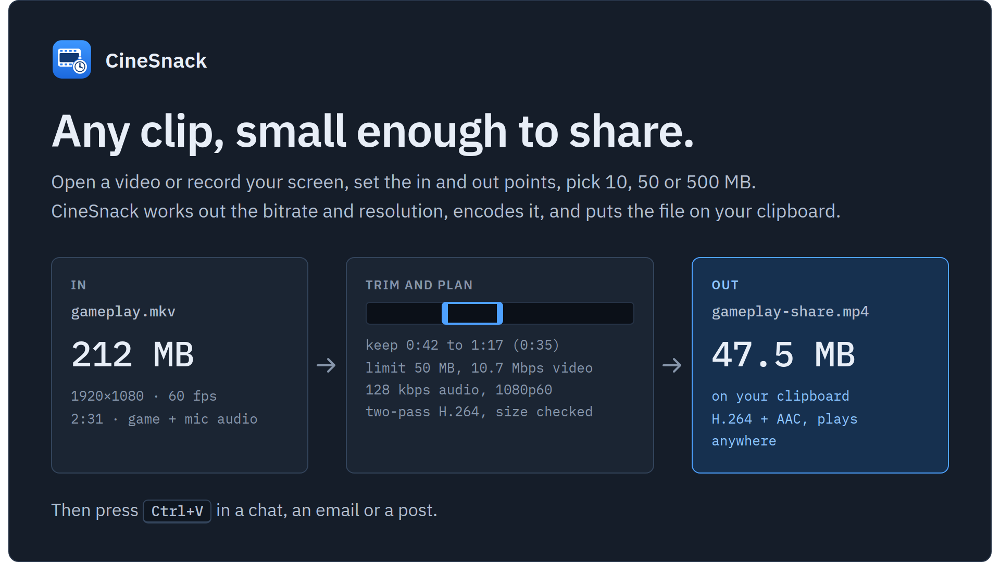
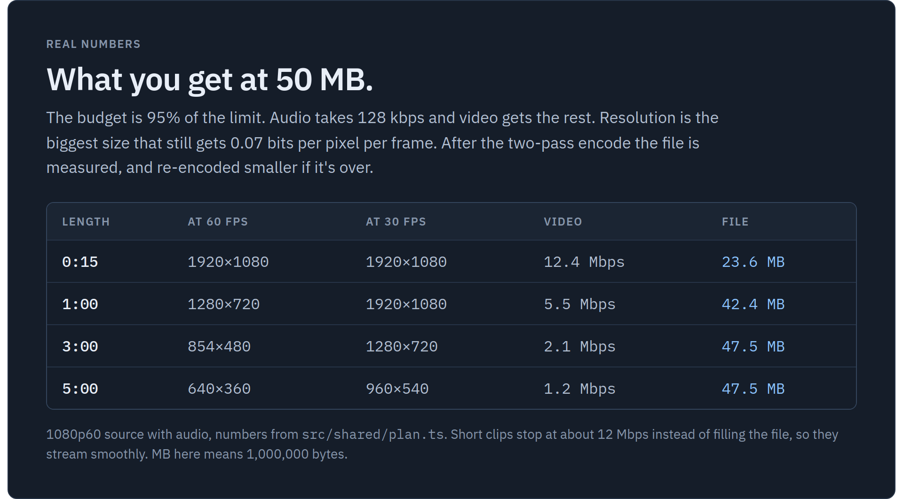
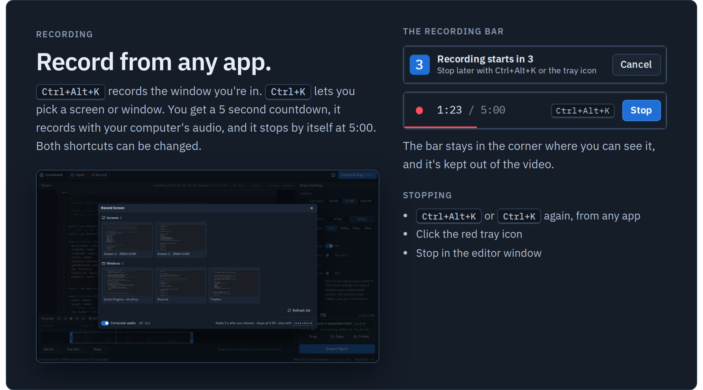
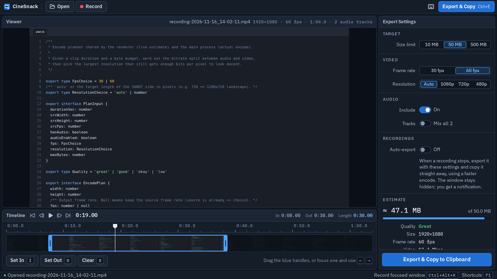

<!-- hypedoc:start -->
<!-- Generated by HypeDoc. Edit the .html sources and run `hypedoc build`; changes inside this block are overwritten. -->
<p align="center">
  
</p>
<p align="center">
  
</p>
<p align="center">
  
</p>
<!-- hypedoc:end -->

# CineSnack

A small desktop video editor for one job: turn a clip into an MP4 under 50 MB, with the audio intact, and put it on your clipboard. Open a file or record your screen, set in and out points on the timeline, and export. The last step is <kbd>Ctrl</kbd>+<kbd>V</kbd> wherever you're sharing it.

[Download the latest release](https://github.com/stuyk/cinesnack/releases/latest) · [Website](https://stuyk.github.io/cinesnack/)

<p align="center"></p>

## What it does

- **Fits the limit.** Pick 10 MB, 50 MB or 500 MB, the common upload limits for chat apps and email. MB means 1,000,000 bytes, so the file is under the limit however a site counts it. The encoder aims at 95% of that, runs two-pass H.264, measures the file and re-encodes smaller if it's still over. When a clip can't fit at a watchable quality, export is disabled and the estimate tells you to trim.
- **Keeps the audio.** AAC at 128 kbps when there's room, less on long clips. Multi-track files such as OBS game + mic can be mixed down to one track.
- **Plays everywhere.** H.264 High + AAC in an MP4 with the index at the front, a keyframe every 2 seconds, capped peaks, and a constant standard frame rate (a 59.83 fps screen recording comes out at 60). Auto resolution tops out at 1080p and video at about 12 Mbps, so short clips don't buffer in chat apps, browsers or phones.
- **Picks the resolution.** Auto uses the biggest size up to 1080p that still gets 0.07 bits per pixel per frame, or you can lock 1080p, 720p or 480p. It never upscales, and a 30 fps source stays at 30.
- **Trims on a timeline.** Ruler, filmstrip, draggable in and out handles. The handles are keyboard sliders too: focus one and use the arrow keys to move a frame at a time.
- **Records.** <kbd>Ctrl</kbd>+<kbd>Alt</kbd>+<kbd>K</kbd> records the window you're in, from any app. <kbd>Ctrl</kbd>+<kbd>K</kbd> lets you pick a screen or window. Either one again stops. You get a 5 second countdown, and it records with computer audio until you stop it or it reaches 5:00. The recording bar stays on screen in the corner, but it's kept out of the video.
- **Auto-export.** Turn on Auto-export in Export Settings (or press <kbd>A</kbd>) and every recording is exported and copied the moment you stop it, with a faster encoder preset. The window stays hidden and a notification tells you when it's ready to paste.
- **Runs from the keyboard.** Every action is in the menu bar with its shortcut. <kbd>F1</kbd> lists them, and you can rebind any of them there.
- **Lives in the tray.** Closing the window keeps CineSnack running. The tray icon turns red while recording and a click stops it.
- **Stays local.** ffmpeg is bundled. Nothing is uploaded and there's no telemetry.

Exports go to `Videos/CineSnack/`, recordings to `Videos/CineSnack/Recordings/`.

## Keyboard shortcuts

| Action | Shortcut |
|---|---|
| Open video | <kbd>Ctrl</kbd>+<kbd>O</kbd> |
| Record the focused window (any app; again to stop) | <kbd>Ctrl</kbd>+<kbd>Alt</kbd>+<kbd>K</kbd> |
| Pick a screen or window to record (any app; again to stop) | <kbd>Ctrl</kbd>+<kbd>K</kbd> |
| Export and copy | <kbd>Ctrl</kbd>+<kbd>E</kbd> |
| Copy last export again | <kbd>Ctrl</kbd>+<kbd>Shift</kbd>+<kbd>C</kbd> |
| Play / pause | <kbd>Space</kbd> |
| Previous / next frame | <kbd>←</kbd> / <kbd>→</kbd> |
| Back / forward 1 second | <kbd>Shift</kbd>+<kbd>←</kbd> / <kbd>Shift</kbd>+<kbd>→</kbd> |
| Set in / out point | <kbd>I</kbd> / <kbd>O</kbd> |
| Go to in / out point | <kbd>Shift</kbd>+<kbd>I</kbd> / <kbd>Shift</kbd>+<kbd>O</kbd> |
| Clear in and out | <kbd>X</kbd> |
| Size limit 10 / 50 / 500 MB | <kbd>1</kbd> / <kbd>2</kbd> / <kbd>3</kbd> |
| Toggle audio | <kbd>M</kbd> |
| Toggle auto-export for recordings | <kbd>A</kbd> |
| All shortcuts, and rebinding | <kbd>F1</kbd> |

On macOS, <kbd>Ctrl</kbd> is <kbd>⌘</kbd>. Changed shortcuts are saved to `keybindings.json` in the app's user data folder. On macOS, "record focused window" records the screen under the cursor, because window capture isn't supported there yet.

## Platforms

| | Open, trim, export, clipboard | Screen recording | Computer audio while recording |
|---|---|---|---|
| Linux (X11) | Yes | Screens and windows (`x11grab`) | Yes, via `parec` (PulseAudio or PipeWire-Pulse) |
| Linux (Wayland) | Yes | Not yet | No |
| Windows | Yes | Screens and windows (`gdigrab`), experimental | Chromium loopback, experimental |
| macOS | Yes | Whole screens only (`avfoundation`), experimental | macOS 13+, experimental |

- Linux: `parec` ships in `pulseaudio-utils` (Debian/Ubuntu) or `libpulse` (Arch/Fedora). Clipboard copy uses `xclip` or `wl-copy` when installed, so the file survives CineSnack closing. The tray icon needs an AppIndicator/StatusNotifier host; on stock GNOME that's the AppIndicator extension. Global shortcuts and focused-window detection need X11 (`xprop`, from `x11-utils`).
- macOS: grant Screen Recording permission the first time you record.
- Keeping the recording bar out of the video: Windows and macOS exclude it from capture. On X11, window recordings never contain other windows. For full-screen X11 recordings, CineSnack also grabs the window underneath the bar and paints its pixels over the bar's spot in every frame. The bar can't be dragged during those recordings, since the spot is fixed when recording starts.

## How the size math works

```
probe -> budget = limit x 0.95 -> audio 128/96/64/48 kbps -> video = budget - audio
      -> resolution = largest rung <= 1080p with >= 0.07 bits/pixel/frame
      -> video capped at 0.1 bits/pixel/frame (~12 Mbps at 1080p60) so it streams smoothly
      -> libx264 pass 1 -> pass 2 (+faststart) -> measure -> over? shrink bitrate, retry (max 3)
      -> file onto the clipboard
```

- [`src/shared/plan.ts`](src/shared/plan.ts) is the planner. The live estimate and the real encode both call it, so what you see before export is what you get.
- [`src/main/encoder.ts`](src/main/encoder.ts) runs the two-pass encode and the size check. Both passes resample to a constant frame rate, which screen recordings need.
- [`src/main/recorder.ts`](src/main/recorder.ts) grabs video with ffmpeg and audio separately (`parec` on Linux, Chromium loopback elsewhere) and feeds the audio over a localhost socket. `-t 300` is the hard cap.
- [`src/shared/commands.ts`](src/shared/commands.ts) is the single list of actions and shortcuts. The native menu, the key handling and the shortcuts sheet are built from it.
- [`src/main/clipboard.ts`](src/main/clipboard.ts) puts a real file on the clipboard: `Set-Clipboard -LiteralPath` on Windows, `osascript` on macOS, `text/uri-list` on Linux.

## Building

Needs Node 20+ or Bun.

```bash
bun install          # or npm install
npm run dev          # run with hot reload
npm test             # unit tests
CINESNACK_INTEGRATION=1 npx vitest run encoder.integration   # real ffmpeg encodes, slow

npm run build:linux  # AppImage, deb, tar.gz
npm run build:win    # NSIS installer and portable exe
npm run build:mac    # dmg
```

- `npm run assets` renders [`build/icon.svg`](build/icon.svg) to every icon size (PNG, ICO, ICNS) and [`branding/social-card.html`](branding/social-card.html) to `docs/social-preview.png`.
- `hypedoc build` re-renders the README graphics from `.hypedoc/*.html`, using the screenshots in `docs/screenshots/`.

```
src/
├── main/        Electron main: ffmpeg, encoder, recorder, clipboard, menu, tray, IPC
├── preload/     window.api bridge
├── renderer/    SolidJS UI
└── shared/      size planner, command list and types used by both sides
build/           app icons (icon.svg is the source)
branding/        shared brand CSS and the social card
docs/            GitHub Pages site and screenshots
.hypedoc/        README graphic sources
```

## License

See [LICENSE](LICENSE).
